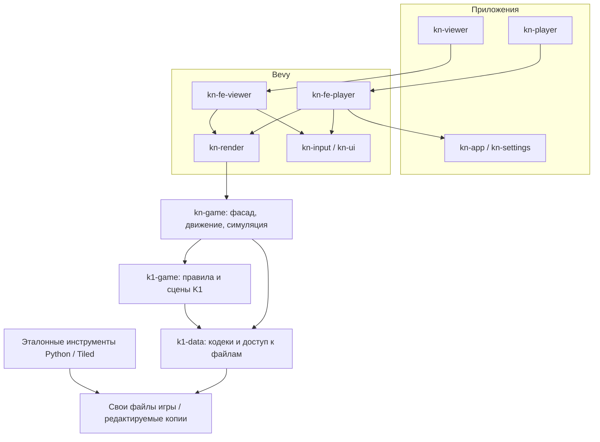

# Архитектура

Здесь описаны общая архитектура re-konung, компоненты, их обязанности, допустимые зависимости и целевое устройство. Остальные документы ссылаются сюда: [Rust](docs/development/rust/README.md) хранит технические подробности и замеры, [обзор серии](docs/research/series.md) — части и издания, [оглавление](docs/README.md) — навигацию по форматам. Ожидаемый опыт игрока и назначение ориентиров описаны в [принципах продукта](docs/development/design.md).

## Обзор

re-konung исследует и воссоздаёт движок серии «Князь» (1С/Snowball). Независимые реализации имеют разные роли:

- **Rust, crates/** — сам движок, ремастер на Bevy. Только эта часть предназначена стать игрой.
- **Python, konung/** и **расширение Tiled, tiled/konung/** — эталонные инструменты: разбирают и отображают форматы, позволяют редактировать карты в Tiled. Rust не связывается с ними и не вызывает их; зависимостей времени исполнения нет в обе стороны. Python — эталон форматов и арбитр расхождений, закреплённый тестами.
- **original/** — собственные файлы владельца лицензионной копии. Не коммитятся и не распространяются.

Свойства стека Rust:

- **Записываемые форматы сохраняются побайтно.** Чтение → запись воспроизводит каждый файл каждого издания. Тесты проверяют карты Konung.N, размещение света LIGHTS.N и начальные состояния Game.N, включая обучающие аналоги. Для форматов только чтения (GRAPH.RES, Objects.res, LIGHTS.RES, огни, таблицы EXE) побайтная запись — цель, не текущая гарантия.
- **Данные и игровая логика не зависят от Bevy.** k1-data, k1-game и kn-game собираются и проверяются без окна/GPU. Bevy появляется в слое 03 и выше.

## Схема слоёв

Стрелки обозначают текущий логический поток данных и управления; точные зависимости Cargo перечислены отдельно. Python и Tiled независимы от движка Rust.

## Готовность возможностей

Статус означает покрытие реализацией, не доказанность исходного правила. Уверенность хранится в исследованиях. Будущие строки обозначают пробелы, не расписание.

| Возможность | Сейчас |
|---|---|
| Форматы K1, эталонный рендерер, карты/состояние в Tiled | Реализованы для описанных форматов; графика только читается, карты/состояние записываются побайтно |
| Сцены Rust, графика, анимация, камера, просмотрщик | Реализованы: просмотр, проверки без окна, диагностические слои и показатели |
| Общий движок движения и восстановленные решения существ | Реализованы; оба фронтенда Bevy запускают симуляцию, неизвестное поведение остаётся нереализованным |
| Время, фоновое/тайловое освещение, управление просмотрщика | Реализованы; исходные настройки по умолчанию и активация постоянного света карт ещё исследуются |
| Меню игры, настройки, конструктор новой игры | Реализованы: сохранение настроек и настроенный стартовый сеанс; полного игрового цикла нет |
| Приказы движения герою | Левый клик задаёт точную цель общему движку; принятие и отказ видны в окне, мир продолжает симуляцию |
| Ближние нападения | Монстры выбирают цель, преследуют и атакуют; герой атакует по клику и отвечает соседнему врагу. Урона, попаданий, смерти и стрельбы пока нет |
| Взаимодействие с инвентарём, диалоги, задания | Неполные либо отсутствуют; данные и отображение экипировки не означают готовность этих систем |
| Сохранение/загрузка сеансов, переходы мира, производство/дань, расписания NPC | Не реализованы |
| K2/K2.5 и выбор игрового бэкенда | Условная цель; общность форматов и движка не проверена |
| Общий крейт kn-data | Только кандидат, в рабочем пространстве и плане отсутствует |

## Обязанности компонентов

| Слой | Компонент | Путь | Отвечает за | Не должен знать |
|---|---|---|---|---|
| 01 | kn-player | crates/apps/player | Бинарный re-konung: CLI --game-dir/--new-game/--settings, загрузка настроек с типизированными ошибками и безопасными значениями без изменения плохого файла, открытие каталога, разрешение героев, PlayerConfig для фронтенда | Bevy, форматы K1 |
| 01 | kn-app | crates/apps/kn-app | Чистое ядро приложения: экраны, типизированные действия, reducer AppController и таблица переходов, эффекты и ошибки сеанса/сохранения; тесты без окна | Bevy, kn-game, форматы, фронтенды |
| 01 | kn-settings | crates/apps/kn-settings | Значения по умолчанию, проверка, Language, версионированный JSON. Загрузка не пишет; сохранение не теряет прежний файл: tmp + rename, .bak для повреждённого/более нового формата | Bevy, игра, окно |
| 01 | kn-viewer | crates/apps/viewer | CLI, startup configuration and headless check/simulate and verified debug-journal replay reports; the control client connects to an existing viewer session without opening game data | Сборка приложения Bevy, связанного лишь транзитивно |
| 02 | kn-fe-player | crates/frontend/bevy/player | Сборка Bevy App, окно, привязка камеры, AppFlow над kn-app: flush → effects → results → screens; один session_watch сообщает готовность только по наблюдению. Создание/удаление стартового сеанса, меню/настройки/загрузка, двухъязычный интерфейс | CLI; не реализует правила/кодеки, текущие адаптеры K1 описаны ниже |
| 02 | kn-fe-viewer | crates/frontend/bevy/viewer | Bevy workspace, shared typed actions/read projection, inspection and selection, map/display/playback controls, frame diagnostics, authenticated loopback sessions, runtime debug-player controls/scoped geometry and paired workspace capture | CLI; не реализует правила/кодеки, текущие адаптеры K1 описаны ниже |
| 03 | kn-render | crates/frontend/bevy/render | Scene pieces to z-sorted sprites, texture/alpha-mask cache, displayed-frame creature picking/bounds and viewport-aware camera. Shared creature animation, optionally budgeted simulation catch-up and debug-journal/animation replay bridge, compound clips/nodes and depth; group visibility changes do not rebuild scenes | K1, форматы, правила, привязки ввода |
| 03 | kn-input | crates/frontend/bevy/input | Механизмы ввода: направление клавиатуры, смещение мыши, накопление колеса в ступени масштаба | Типы камеры, интерфейс, правила |
| 03 | kn-ui | crates/frontend/bevy/ui | Общие параметры дизайна, PT Sans, тема Feathers, отражение флажков, захват указателя | Панели, состояние виджетов, рендеринг, привязки ввода, правила |
| 04 | kn-game | crates/game/kn-game | Фасад серии Game: каталог, карты, Scene, текстуры, check; модель Scene/Piece/TextureId/Animation/PieceGroup без Bevy. Общий движок: изометрическая мелкая сетка, проходимость/занятость, A*, перепрокладка, шаги/события, детерминированный RNG; применение решений и задержка повторов отказавших приказов | Bevy, окно, GPU |
| 05 | k1-game | crates/game/k1/k1-game | Специфика K1: ресурсы, ключи текстур, декодирование RGBA, список отрисовки с группами, сборка кадров, правила существ | Bevy, другие части |
| 06 | k1-data | crates/game/k1/k1-data | Чистые parse(data: bytes) и отдельная файловая обвязка: repo, map, game_state, game_edit, graph_res, objects_res, lights_res, flames_res, executable, characters, newh_res, rle, palette | Правила, Bevy, файловая система внутри парсера |
| 08 | Python | konung/ | Эталонные парсер, рендерер и CLI konung; арбитр расхождений с Rust | —, независим от Rust |
| 08 | Расширение Tiled | tiled/konung/ | Открытие Konung.N с объектами Game.N и побайтная запись; место редактирования карт | —, независимо от Rust |

### Правила границ

- **kn-game — чистая модель мира Rust.** Даёт сцены и симуляцию без типов Bevy; исключения адаптеров K1 перечислены ниже. Движение не читает файлы: Passage передаёт проходимость, Pace — длительность шага в тиках. Движок считает тики, но не имеет собственных часов; длительность тика задаётся снаружи.
- **k1-game и условный k2-game — знания части:** ресурсы, текстуры, порядок рисования, поведение; для K2/K2.5 общность семейства должна быть исследована. Правила берутся из оригинала; неподтверждённые записываются как неизвестные и не реализуются.
- **k1-data и условный k2-data — форматы и сериализация.** Чтение и побайтная запись с сохранением неизвестных байтов.
- **kn-render, kn-input, kn-ui — общие механизмы Bevy.** kn-input и kn-ui зависят только от bevy.
- **Анимация существ имеет один механизм в kn-render.** CreatureAnimationPlugin и CreatureMotion::request подключают весь конвейер с порядком систем относительно Clock. Фронтенд добавляет только своё: метки и диагностика просмотрщика выполняются после последнего набора систем. Состояние существа, особая анимация 4 и однократный переход в покой выбираются в k1-game::creature_anim за kn_game::Simulation; рендеринг читает стадию и меняет кадры, не принимает игровых решений. Тики приходят из Clock сцены.
- **kn-fe-* собирают приложения Bevy** и определяют реакцию на действия/пересборку. Не реализуют кодеки или правила, но сейчас напрямую вызывают парсеры света и модели времени/освещения K1; игра также декодирует портреты NEWH.
- **kn-player/kn-viewer — исполняемые оболочки:** CLI и завершение процесса, начальная передача конфигурации.
- **Просмотрщик только читает.** Редактирование игровых файлов принадлежит расширению Tiled.
- **Debug history belongs to kn-game.** Source-derived actor profiles, runtime registration, deterministic command outcomes and replay scripts remain Bevy-free. The optional kn-render bridge maps journal ticks to scene animation; kn-fe-viewer owns marker/overlay presentation and export actions.
- **Workspace actions belong to kn-fe-viewer.** UI and local session control use one typed action dispatcher on the main thread and one read projection. kn-render supplies picking, bounds, viewport and catch-up mechanisms without knowing interaction modes or protocol commands; captures and session metadata stay in local output files.
- **Python и Tiled независимы от Rust при исполнении.** Они остаются эталонами; Rust пока их не заменяет.

## Границы зависимостей

Схема показывает логические слои, не рёбра Cargo. Таблица отражает объявленные Cargo.toml зависимости: рабочее пространство crates/Cargo.toml, resolver 3, edition 2024, Bevy 0.20.

| Крейт | Локальные зависимости | Внешние |
|---|---|---|
| kn-player | kn-fe-player, kn-game, kn-settings | clap |
| kn-viewer | kn-fe-viewer, kn-game | clap, serde, serde_json, thiserror |
| kn-app | kn-settings | — |
| kn-settings | — | dirs, serde, serde_json |
| kn-fe-player | kn-app, kn-settings, kn-game, kn-render, kn-input, kn-ui, k1-data, k1-game | bevy (bevy_feathers) |
| kn-fe-viewer | kn-game, kn-render, kn-input, kn-ui, k1-data, k1-game | bevy (bevy_feathers), serde, serde_json, getrandom |
| kn-render | kn-game | bevy, thiserror |
| kn-input | — | bevy |
| kn-ui | — | bevy (bevy_feathers) |
| kn-game | k1-data, k1-game | pathfinding, serde, thiserror |
| k1-game | k1-data | thiserror |
| k1-data | — | thiserror |

Тестовые зависимости не перечислены: tempfile в k1-data, k1-game, kn-game и kn-viewer нужен для синтетических файлов и не добавляет ребра между крейтами.

Текущие инварианты:

- Зависимости направлены вниз; в слоях 03–06 типы K1 именуют только крейты K1 и фасад kn-game.
- kn-input и kn-ui — листья, только bevy.
- k1-data, k1-game, kn-game, kn-app, kn-settings не зависят от Bevy, тестируются без окна; kn-viewer check не создаёт окно/GPU.
- В рабочем пространстве 12 участников, нет k2-* и kn-data.
- kn-app обращается к игре через типизированные эффекты, исполняемые kn-fe-player; игровой домен kn-game и ниже не знает ядра приложения.

## Поддержка нескольких игр

В серии четыре игры; проект рассматривает первые три, причём K2/K2.5 только после подтверждения общего движка. Трёхмерная K3 вне рамок; см. [серию](docs/research/series.md). Сейчас реализована только первая:

- **«Князь: Легенды Лесной страны», 1999:** k1-data/k1-game, Python, Tiled.
- **«Князь 2», 2003, и «Князь 2.5», 2004–2005:** условная общая пара k2-data/k2-game, не по паре на часть. Файлы ещё не исследованы; возможностей K2 пока нет. Годы, команды и издатели — в [обзоре](docs/research/series.md).

Решения отделены от гипотез:

- **Принятое решение:** общий код выделяется после доказательства общности. Исключение — движение уже в kn-game: рабочее предположение о близости K1/K2 и беге как видимом отличии помещается в одну модель; специфика остаётся в k1-game.
- **Гипотеза:** K2/K2.5 достаточно близки по движку, форматам и правилам для общей пары крейтов. Файлами не проверено, см. [обзор серии](docs/research/series.md); k2-game/k2-data условны.
- **Гипотеза о движении:** бег — заметное отличие K2 от K1; прочие различия ещё не проверены.
- **Не расписание:** форматы K2/K2.5 не реализованы, сроков здесь нет.

Добавление части должно сохранять API kn-game и добавлять бэкенд k2-game/k2-data рядом с K1, с выбором на границе приложения. Сейчас фасад явно привязан к K1; отсутствие выбора — известный пробел.

Граница приложения уже существует: kn-app запускает сеанс только эффектом StartSession; это место для будущего выбора игры. Ядро не знает конкретную часть; игровое исполнение проходит через фронтенд и kn-game, с текущими адаптерами ниже. Выбор каталога игры из интерфейса без --game-dir — отдельная будущая задача; сейчас CLI открывает одну игру при запуске.

## Текущее и целевое устройство

Схема отражает существующие слои; таблица возможностей отделяет реализацию от пробелов и условных целей.

| Граница | Цель | Сейчас |
|---|---|---|
| Выбор игры | Независимый от бэкенда kn-game выбирает реализацию за единым API | Прямо зависит от k1-data/k1-game и вызывает их; бэкенд один, выбора нет |
| Исполняемые файлы | Тонкие CLI над фронтендами | Выполнено, но оба также именуют kn-game: открывают игру и строят конфигурацию |
| Отображение | Общие механизмы слоя 03 | kn-render получает модель сцены из kn-game; kn-input/kn-ui зависят только от bevy |
| Адаптеры фронтендов | Данные конкретной игры приходят через фасад | Оба напрямую читают LIGHTS.RES/LIGHTS.N и вызывают модели времени/света k1-game; игра также вызывает k1-data::newh_res для портретов. Это текущие исключения, не зависимости общего рендерера |

Рабочие уточнения:

- kn-viewer содержит библиотеку и бинарный файл, check тестируется через библиотеку; kn-player — только бинарный файл.
- Решения вычисляет k1-game, применяет kn-game::rules с задержкой повторов отказавших приказов. Оба фронтенда используют общий плагин существ; реализовано только восстановленное поведение.
- Сохранение/загрузка сеансов, производство/дань, инвентарь, диалоги, переходы отсутствуют. Время и смена освещения уже работают от тика симуляции; уверенность источников указана в исследованиях.
- Python и Tiled остаются эталонами, Rust пока их не заменяет.

## Возможные компоненты

kn-data — возможный крейт общих моделей: мир, карта, сущность, сцена, состояние, идентификаторы и типы значений, без правил и Bevy. Это **только кандидат**: не участник рабочего пространства, не запланирован, зависимостей нет. Он появится лишь при втором потребителе, подтверждающем независимую переиспользуемость моделей; общий код следует доказанной общности.
