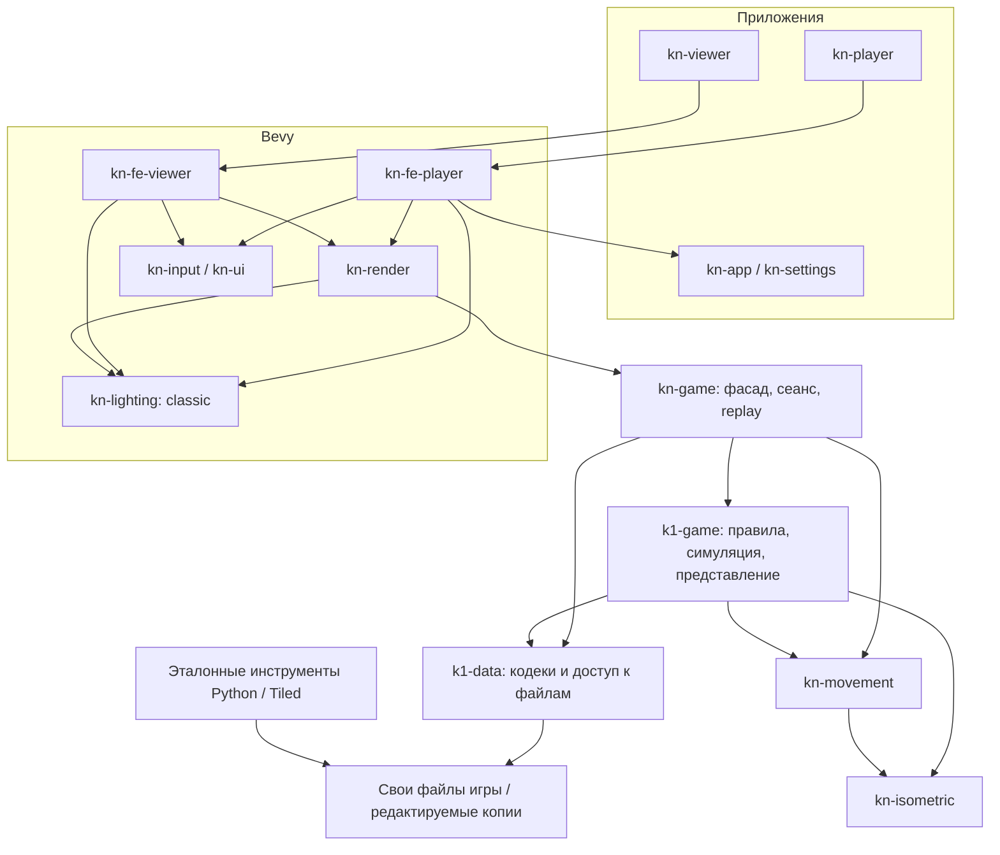

# Архитектура

Здесь описаны общая архитектура re-konung, компоненты, их обязанности, допустимые зависимости и целевое устройство. Остальные документы ссылаются сюда: [Rust](docs/development/rust/README.md) хранит технические подробности и замеры, [обзор серии](docs/research/series.md) — части и издания, [оглавление](docs/README.md) — навигацию по форматам. Ожидаемый опыт игрока и назначение ориентиров описаны в [принципах продукта](docs/development/design.md).

## Обзор

re-konung исследует и воссоздаёт движок серии «Князь» (1С/Snowball). Независимые реализации имеют разные роли:

- **Rust, crates/** — сам движок, ремастер на Bevy. Только эта часть предназначена стать игрой.
- **Python, konung/** и **расширение Tiled, tiled/konung/** — эталонные инструменты: разбирают и отображают форматы, позволяют редактировать карты в Tiled. Rust не связывается с ними и не вызывает их; зависимостей времени исполнения нет в обе стороны. Python — эталон форматов и арбитр расхождений, закреплённый тестами.
- **original/** — собственные файлы владельца лицензионной копии. Не коммитятся и не распространяются.

Свойства стека Rust:

- **Записываемые форматы сохраняются побайтно.** Чтение → запись воспроизводит каждый файл каждого издания. Тесты проверяют карты Konung.N, размещение света LIGHTS.N и начальные состояния Game.N, включая обучающие аналоги. Для форматов только чтения (GRAPH.RES, Objects.res, LIGHTS.RES, огни, таблицы EXE) побайтная запись — цель, не текущая гарантия.
- **Данные и игровая логика не зависят от Bevy.** k1-data, k1-game и kn-game собираются и проверяются без окна/GPU. Bevy появляется в слое 03 и выше.

## Текущая схема слоёв

Стрелки обозначают текущий логический поток данных и управления; точные зависимости Cargo перечислены отдельно. Python и Tiled независимы от движка Rust.

## Готовность возможностей

Статус означает покрытие реализацией, не доказанность исходного правила. Уверенность хранится в исследованиях. Будущие строки обозначают пробелы, не расписание.

| Возможность | Сейчас |
|---|---|
| Форматы K1, эталонный рендерер, карты/состояние в Tiled | Реализованы для описанных форматов; графика только читается, карты/состояние записываются побайтно |
| Сцены Rust, графика, анимация, камера, просмотрщик | Реализованы: просмотр, проверки без окна, диагностические слои и показатели |
| Общий движок движения и восстановленные решения существ | Реализованы; оба фронтенда Bevy запускают симуляцию, неизвестное поведение остаётся нереализованным |
| Время, фоновое/тайловое освещение, управление просмотрщика | Реализованы; исходные настройки по умолчанию и активация постоянного света карт ещё исследуются |
| Меню игры, настройки, конструктор новой игры | Реализованы: сохранение настроек и настроенный стартовый сеанс; полного игрового цикла нет |
| Приказы движения герою | Левый клик задаёт точную цель общему движку; принятие и отказ видны в окне, мир продолжает симуляцию |
| Ближние нападения | Монстры выбирают цель, преследуют и атакуют; герой атакует по клику и отвечает соседнему врагу. Урона, попаданий, смерти и стрельбы пока нет |
| Взаимодействие с инвентарём, диалоги, задания | Неполные либо отсутствуют; данные и отображение экипировки не означают готовность этих систем |
| Сохранение/загрузка сеансов, переходы мира, производство/дань, расписания NPC | Не реализованы |
| K2/K2.5 и выбор игрового бэкенда | Условная цель; общность форматов и движка не проверена |
| Общий крейт kn-data | Только кандидат, в рабочем пространстве и плане отсутствует |

## Текущие обязанности компонентов

| Слой | Компонент | Путь | Отвечает за | Не должен знать |
|---|---|---|---|---|
| 01 | kn-player | crates/apps/player | Бинарный re-konung: CLI --game-dir/--new-game/--settings, загрузка настроек с типизированными ошибками и безопасными значениями без изменения плохого файла, открытие каталога, разрешение героев, PlayerConfig для фронтенда | Bevy, форматы K1 |
| 01 | kn-app | crates/apps/kn-app | Чистое ядро приложения: экраны, типизированные действия, reducer AppController и таблица переходов, эффекты и ошибки сеанса/сохранения; тесты без окна | Bevy, kn-game, форматы, фронтенды |
| 01 | kn-settings | crates/apps/kn-settings | Значения по умолчанию, проверка, Language, версионированный JSON. Загрузка не пишет; сохранение не теряет прежний файл: tmp + rename, .bak для повреждённого/более нового формата | Bevy, игра, окно |
| 01 | kn-viewer | crates/apps/viewer | CLI, начальная конфигурация, отчёты check/simulate и проверенное воспроизведение журнала без окна; клиент управления подключается к открытому просмотрщику без загрузки игровых файлов | Сборка приложения Bevy, связанного лишь транзитивно |
| 02 | kn-fe-player | crates/frontend/bevy/player | Сборка Bevy App, окно, привязка камеры, AppFlow над kn-app: flush → effects → results → screens; один session_watch сообщает готовность только по наблюдению. Создание/удаление стартового сеанса, меню/настройки/загрузка, двухъязычный интерфейс | CLI, форматы и правила K1 |
| 02 | kn-fe-viewer | crates/frontend/bevy/viewer | Рабочее пространство Bevy: типизированные действия и проекция состояния, выбор объектов, управление картой и воспроизведением, диагностика кадров, локальное управление с аутентификацией, отладочный персонаж и снимки | CLI, форматы и правила K1 |
| 03 | kn-render | crates/frontend/bevy/render | Scene → спрайты с глубиной, кеш текстур и масок прозрачности, выбор существ по видимому кадру, камера; общий конвейер анимации и ограниченного догоняющего исполнения симуляции, мост replay и адаптер освещения; смена видимости не пересобирает сцену | K1, форматы, правила, привязки ввода |
| 03 | kn-lighting | crates/frontend/bevy/lighting | Метка освещаемой поверхности и порядок применения; classic: маски, материалы, шейдер и обновление параметров | K1, kn-game, kn-render, существа и часы игры |
| 03 | kn-input | crates/frontend/bevy/input | Механизмы ввода: направление клавиатуры, смещение мыши, накопление колеса в ступени масштаба | Типы камеры, интерфейс, правила |
| 03 | kn-ui | crates/frontend/bevy/ui | Общие параметры дизайна, PT Sans, тема Feathers, отражение флажков, захват указателя | Панели, состояние виджетов, рендеринг, привязки ввода, правила |
| 04 | kn-game | crates/game/kn-game | Фасад Game: загрузка, каталог, карты, сеанс и отчёты check; Scene/Piece/TextureId/Animation без Bevy; журнал команд и replay | Bevy, окно, GPU |
| 05 | k1-game | crates/game/k1/k1-game | Специфика K1: правила и симуляция, размещение, бой, время, ресурсы, сцены, текстуры, кадры и CPU-модель света | Bevy, другие части |
| 06 | k1-data | crates/game/k1/k1-data | Чистые parse(data: bytes) и отдельная файловая обвязка: repo, map, game_state, game_edit, graph_res, objects_res, lights_res, flames_res, executable, characters, newh_res, rle, palette | Правила, Bevy, файловая система внутри парсера |
| 07 | kn-movement | crates/shared/movement | Проходимость, занятость, A*, шаги, события, World, RNG, StepDurations | K1, Bevy, чтение файлов, собственные часы |
| 07 | kn-isometric | crates/shared/isometric | Клетки, направления, соседство и проекция | K1, Bevy, размеры игровых карт, стоимость пути |
| 08 | Python | konung/ | Эталонные парсер, рендерер и CLI konung; арбитр расхождений с Rust | —, независим от Rust |
| 08 | Расширение Tiled | tiled/konung/ | Открытие Konung.N с объектами Game.N и побайтная запись; место редактирования карт | —, независимо от Rust |

### Правила границ

- **kn-game — фасад Rust без Bevy.** Даёт готовые сцены и явную оболочку сеанса K1. **kn-movement** не читает файлы: Passage передаёт проходимость, Pace — длительность шага в тиках. Движок считает тики, но не имеет собственных часов; длительность тика задаётся снаружи.
- **k1-game и условный k2-game — знания части:** ресурсы, текстуры, порядок рисования, поведение; для K2/K2.5 общность семейства должна быть исследована. Правила берутся из оригинала; неподтверждённые записываются как неизвестные и не реализуются.
- **k1-data и условный k2-data — форматы и сериализация.** Чтение и побайтная запись с сохранением неизвестных байтов.
- **kn-render, kn-lighting, kn-input, kn-ui — механизмы Bevy.** kn-lighting, kn-input и kn-ui зависят только от bevy. Рендерер связывает освещение с поверхностями и положением существ; выбор материала принадлежит classic.
- **Анимация существ имеет один механизм в kn-render.** CreatureAnimationPlugin и CreatureMotion::request подключают весь конвейер с порядком систем относительно Clock. Фронтенд добавляет только своё: метки и диагностика просмотрщика выполняются после последнего набора систем. Состояние существа, особая анимация 4 и однократный переход в покой выбираются в k1-game::creature_anim за kn_game::Simulation; рендеринг читает стадию и меняет кадры, не принимает игровых решений. Тики приходят из Clock сцены.
- **kn-fe-* собирают приложения Bevy** и определяют реакцию на действия/пересборку. Данные света и портретов, время и параметры освещения приходят через kn-game; общий адаптер kn-render переводит параметры света в типы Bevy.
- **kn-player/kn-viewer — исполняемые оболочки:** CLI и завершение процесса, начальная передача конфигурации.
- **Просмотрщик только читает.** Редактирование игровых файлов принадлежит расширению Tiled.
- **Журнал отладки принадлежит kn-game.** Фасад преобразует сериализуемые команды в операции симуляции K1 и её снимки обратно в данные replay. K1 не знает формата журнала. Мост kn-render связывает тики журнала с анимацией; kn-fe-viewer отображает маркеры и геометрию, экспортирует сценарии.
- **Действия просмотрщика принадлежат kn-fe-viewer.** UI и локальное управление используют один диспетчер на главном потоке и одну проекцию состояния. kn-render предоставляет выбор объектов, границы, viewport и догоняющее исполнение без знания режимов взаимодействия или команд протокола. Снимки и метаданные сеанса остаются в локальных файлах.
- **Python и Tiled независимы от Rust при исполнении.** Они остаются эталонами; Rust пока их не заменяет.

## Текущие границы зависимостей

Схема показывает логические слои, не рёбра Cargo. Таблица отражает объявленные Cargo.toml зависимости: рабочее пространство crates/Cargo.toml, resolver 3, edition 2024, Bevy 0.20.

| Крейт | Локальные зависимости | Внешние |
|---|---|---|
| kn-player | kn-fe-player, kn-game, kn-settings | clap |
| kn-viewer | kn-fe-viewer, kn-game, kn-movement | clap, serde, serde_json, thiserror |
| kn-app | kn-settings | — |
| kn-settings | — | dirs, serde, serde_json |
| kn-fe-player | kn-app, kn-settings, kn-game, kn-render, kn-lighting, kn-input, kn-ui, kn-isometric, kn-movement | bevy (bevy_feathers) |
| kn-fe-viewer | kn-game, kn-render, kn-lighting, kn-input, kn-ui, kn-isometric | bevy (bevy_feathers), serde, serde_json, getrandom |
| kn-render | kn-game, kn-lighting | bevy, thiserror |
| kn-lighting | — | bevy |
| kn-input | — | bevy |
| kn-ui | — | bevy (bevy_feathers) |
| kn-game | k1-data, k1-game, kn-isometric, kn-movement | serde, thiserror |
| k1-game | k1-data, kn-isometric, kn-movement | thiserror |
| k1-data | — | thiserror |
| kn-movement | kn-isometric | pathfinding |
| kn-isometric | — | — |

Тестовые зависимости не перечислены. В частности, K1 в тестах рендерера и просмотрщика нужен для синтетических проверок границ; рабочий код фронтендов и рендерера K1 не импортирует. tempfile обслуживает синтетические файлы.

Текущие инварианты:

- Зависимости направлены вниз; в слоях 03–06 типы K1 именуют только крейты K1 и фасад kn-game.
- kn-lighting, kn-input и kn-ui — листья, только bevy.
- k1-data, k1-game, kn-game, kn-movement, kn-isometric, kn-app, kn-settings не зависят от Bevy, тестируются без окна; kn-viewer check не создаёт окно/GPU.
- В рабочем пространстве 15 участников, нет k2-* и kn-data.
- kn-app обращается к игре через типизированные эффекты, исполняемые kn-fe-player; игровой домен kn-game и ниже не знает ядра приложения.

## Поддержка нескольких игр

В серии четыре игры; проект рассматривает первые три, причём K2/K2.5 только после подтверждения общего движка. Трёхмерная K3 вне рамок; см. [серию](docs/research/series.md). Сейчас реализована только первая:

- **«Князь: Легенды Лесной страны», 1999:** k1-data/k1-game, Python, Tiled.
- **«Князь 2», 2003, и «Князь 2.5», 2004–2005:** условная общая пара k2-data/k2-game, не по паре на часть. Файлы ещё не исследованы; возможностей K2 пока нет. Годы, команды и издатели — в [обзоре](docs/research/series.md).

Решения отделены от гипотез:

- **Принятое решение:** общий код выделяется после доказательства общности. Исключение — kn-movement: рабочее предположение о близости K1/K2 и беге как видимом отличии помещается в одну модель; специфика остаётся в k1-game.
- **Гипотеза:** K2/K2.5 достаточно близки по движку, форматам и правилам для общей пары крейтов. Файлами не проверено, см. [обзор серии](docs/research/series.md); k2-game/k2-data условны.
- **Гипотеза о движении:** бег — заметное отличие K2 от K1; прочие различия ещё не проверены.
- **Не расписание:** форматы K2/K2.5 не реализованы, сроков здесь нет.

Добавление части должно сохранять API kn-game и добавлять бэкенд k2-game/k2-data рядом с K1, с выбором на границе приложения. Сейчас фасад явно привязан к K1; отсутствие выбора — известный пробел.

Граница приложения уже существует: kn-app запускает сеанс только эффектом StartSession; это место для будущего выбора игры. Ядро не знает конкретную часть; игровое исполнение проходит через фронтенд и kn-game. Выбор каталога игры из интерфейса без --game-dir — отдельная будущая задача; сейчас CLI открывает одну игру при запуске.

## Область фасада

kn-game предоставляет готовые данные и явную оболочку сеанса K1. Универсальный
интерфейс игровых бэкендов не вводится до появления исследованной второй части.
CLI открывает игру и передаёт конфигурацию фронтенду. kn-viewer содержит
библиотеку и бинарный файл; его отчёты без окна проверяются через библиотеку.
Оба фронтенда используют один конвейер существ и адаптер освещения.

## Организация модулей

Компоненты имеют явные границы, чтобы задачи сопровождения можно было
локализовать по модулям. `shared` — каталог самостоятельных kn-isometric
и kn-movement, а не общий крейт утилит. kn-lighting располагается рядом
с остальными библиотеками Bevy.

Общая геометрия нужна уже существующим потребителям: движению, правилам K1
и отображению. Её выделение не подтверждает общность K1/K2. Размеры карты
K1 и конструктор её сетки остаются в адаптере K1; стоимость шагов и округление
эвристики A* принадлежат kn-movement. Геометрия определяет соседство у вершины,
а движок движения решает, разрешён ли проход. Перевод оси Y в систему Bevy
остаётся в адаптере представления. Формулы k1-data не заменяются механически:
их знаковые и дробные входы имеют отдельный контракт.

Внутренняя организация игровых и визуальных компонентов:

| Компонент | Модули и ответственность |
|---|---|
| k1-data | Форматы и отдельный доступ к файлам; текущий контракт сохраняется |
| k1-game | `rules`: поведение, бой, размещение, игровое время; `simulation`: исполнение правил; `presentation`: сцены, позы, текстуры и CPU-модель классического света |
| kn-game | `game`: загрузка; `new_game`: выбор героя; `scene`: контракт сцены и преобразования; `visual_assets`: свет и портреты; `session`: фасад симуляции; `inspection`/`debug`: снимки, журнал и replay; `check`: отчёты |
| kn-render | Сцена → сущности Bevy, анимация, камера, выбор объектов и адаптеры к освещению |
| kn-fe-player / kn-fe-viewer | Сборка приложений, пользовательские действия и диагностика; данные конкретной игры приходят через kn-game |

kn-input, kn-ui, kn-app, kn-settings и исполняемые оболочки сохраняют свои
обязанности. Общую модель сцены пока хранит kn-game; специфику её сборки —
модуль представления K1. Выделение kn-scene или k1-scene не требуется.

### Правила внутренних границ

- Правила и симуляция K1 не импортируют сборку сцены. Стадия действия и его
  длительность доступны без построения изображения; представление подбирает
  кадры, экипировку, тени и позиции частей.
- kn-game предоставляет публичный фасад и сохраняет формат сценариев replay. Команды журнала
  переводятся в операции симуляции K1, её снимки — в данные фасада. k1-game
  не импортирует kn-game и не знает DebugScript или MapRef фасада.
- Загрузку LIGHTS.RES/LIGHTS.N и портретов выполняет игровой слой; фронтенды
  получают готовые данные. Преобразование в Bevy-типы находится в общих
  адаптерах kn-render; пользовательские переключатели остаются во фронтендах.
- `lib.rs` объявляет модули и публичный API; реализация разнесена по задачам.
  Короткий README компонента указывает ответственность, зависимости, входные
  точки и профильные проверки, ссылаясь на канонические документы.

### Заменяемое освещение

kn-render передаёт освещаемые поверхности и актуальное пространственное
состояние через контракт kn-lighting. Реализация освещения подключает
материалы или проходы; рендерер не выбирает KonungLightMaterial и не вызывает
классические `ambient()`/`neutral()`. Связь с существами и порядок относительно
анимации задаются в kn-render, поэтому обратной зависимости у kn-lighting нет.

Состояние мира (время, положение объектов, известные источники) отделено от
способа изображения. Точные маски и коэффициенты старого освещения обслуживают
`classic`, но не становятся обязательным API любой будущей реализации.
CPU-модель K1 остаётся вне Bevy; её параметры переводит адаптер представления.

Сейчас реализован только `classic`. Модуль `modern`, его дополнительные
данные и переключатель просмотрщика относятся к отдельному эксперименту. Нормали, высоты и новые
источники света не выводятся из неизвестных исходных правил как установленный
факт. Контракт не ограничивается заменой одного материала, но универсальная
система рендера заранее не строится. Контракт, порядок систем и проверки
описаны в [рендеринге](docs/development/rust/rendering.md#lighting-components).

kn-utils, kn-core, отдельные крейты replay/камеры и инфраструктура выбора
неисследованных игровых бэкендов в эту декомпозицию не входят. Переход на
сторонний тайловый рендерер также рассматривается отдельно. Ускорение сборки
или исполнения не обещается без замеров.

## Возможные компоненты

kn-data — возможный крейт общих моделей: мир, карта, сущность, сцена, состояние, идентификаторы и типы значений, без правил и Bevy. Это **только кандидат**: не участник рабочего пространства, не запланирован, зависимостей нет. Он появится лишь при втором потребителе, подтверждающем независимую переиспользуемость моделей; общий код следует доказанной общности.
